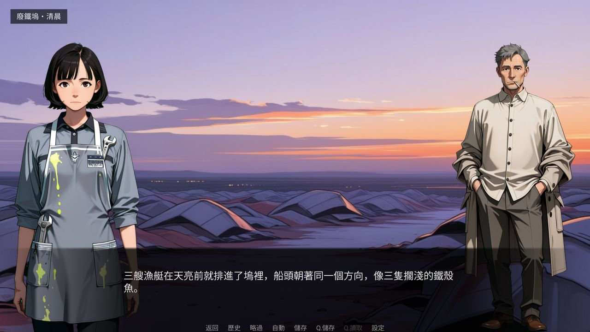
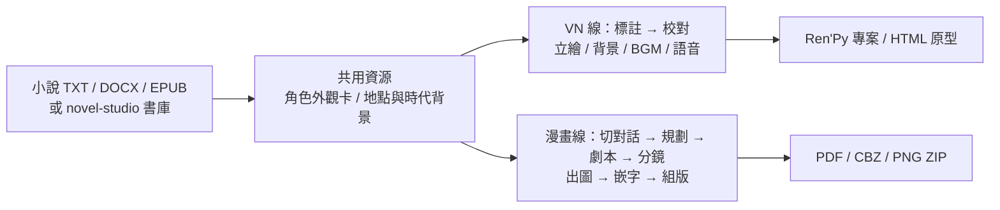

# text_2_visual_novel

**把一本小說，變成可以玩的視覺小說（VN），或是一章一章的漫畫（頁漫）。**

你給它小說文字（或直接接上 [novel-studio](https://github.com/yamasoo/novel-studio) 書庫），它幫你拆出章綱、角色、場景與台詞，讓你在瀏覽器裡逐句校對、管理角色外觀、用 ComfyUI 出圖與配樂配音，最後輸出：

- **視覺小說線（VN）**：可執行的 **Ren'Py 專案**（或免安裝的 HTML 可玩原型）
- **漫畫線（Comic）**：逐頁組版與嵌字的 **PDF／CBZ／單頁 PNG 壓縮檔（ZIP）**

這是一套「人在迴路」的工作台：AI 做粗活，你做判斷。原稿永遠**唯讀不改**，所有產出集中在 `works/`，隨時可重跑單章、單頁或單格。



*《示範》第 1 章：立繪、背景、對話框與語音都是這套管線產出的實驗成果。*

---



## 先玩看看

[下載 Windows 試玩版](https://github.com/yamasoo/text_2_visual_novel/releases/latest)（約 96 MB）

解壓後進入資料夾，執行裡面的 `.exe`。不需要安裝 Ren'Py 或 Python。

這是《示範》的實驗章節，不是完整商業版；Windows 第一次執行可能出現 SmartScreen 警告。

---

## 工作台四區導覽

網頁介面採四區側邊欄，同一本書的**共用資源**只維護一份，VN 與漫畫兩條線直接沿用：

### 1. 共用資源（VN 與漫畫共用正本）
- **總覽**：雙欄檢視全書章節進度、來源書庫更新偵測與一鍵增量同步。
- **角色與外觀**：左名單右詳情（Master-Detail）；支援從 `novel-studio` v3 書庫同步結構化視覺卡、單一或**勾選批次 AI 草擬**（自動帶入時代與服裝基準，支援非人形角色如 `1other`／`dragon`）、頭像與立繪生成、以及漫畫引擎專用的結構化 `t2c` 段落。
- **地點與設定集**：集中管理本書的**時代與服裝基準（`world_context`）**、同步書庫世界觀地點，並支援將重複地點多選合併。

### 2. 視覺小說線（VN）
| 階段 | 你做什麼 | 它做什麼 |
|---|---|---|
| **匯入** | 選 `novel-studio` 書庫（v2／v3）或丟 TXT／MD／DOCX／EPUB | 自動拆章、編段落號、建議書 ID；可一鍵同時啟用漫畫線 |
| **理解** | 按「抽取章綱與角色」 | 讀出章綱、情節點、角色表與初登場章節 |
| **標註** | 按「AI 標註（轉 VN 劇本）」 | 拆出分場、旁白、說話者、表情與演出效果 |
| **校對** | 左原文、右劇本逐句修 | 標出推斷的說話者（`?`）、漏掉的敘述與改寫提醒 |
| **素材與畫風** | 左名單右詳情連續挑圖 | 用 ComfyUI 產出立繪與背景，自動去背、對齊與命名 |
| **音樂與語音** | 選氣氛、配聲線 | 產生 BGM／環境音；可用 **sherpa-onnx 固定聲線**逐句配音（CPU、免 ComfyUI），輸出 OGG 與 `VoiceMap.json` |
| **匯出 Ren'Py** | 填一次 Ren'Py SDK 路徑 | 產生可執行的 Ren'Py 專案（或免 SDK 的 HTML 可玩原型），檢查缺素材與缺字 |

### 3. 漫畫線（頁漫）
漫畫引擎內嵌 `vendor/t2c`（來自 [text2comics](https://github.com/yamasoo/text2comics)，MIT），直接吃共用角色外觀卡與地點設定：

| 分頁 | 功能重點 |
|---|---|
| **專案與設定** | 3 子分頁：`總覽與章節`（限高捲動表＋bible 體檢快照）、`畫風與 LoRA`（選擇全域 `comfy_profile`、畫風預設集 `mono` 日式黑白／`color` 彩色日漫／`american` 美式彩漫、自訂覆蓋與**本專案專屬 LoRA 疊加或取代**）、`嵌字與字型`（對白／喊叫／旁白／狀聲詞字型與直排設定） |
| **章節與劇本** | 從本書寫入原著，一鍵跑四個文字階段（切對話 → 改編規劃 → 劇本 → 分鏡），支援**逐頁斷點續跑**與斜格版型 |
| **分鏡** | 按頁切換的唯讀看板（定高預覽縮圖、鏡位、角色動作表情、台詞與狀聲詞） |
| **出圖** | 按頁切換＋狀態篩選（未選圖／缺圖）；支援整章出圖、只補單頁／單格、**全頁各加畫 N 張**，以及一鍵「未選圖先選第 1 張」 |
| **嵌字** | 畫布拖曳對話框位置與尾巴、調整文字／字級／行數；**狀聲詞（SFX）支援拖曳移動、右下角拉柄縮放、旋轉角度（±45°）與直橫排切換** |
| **頁面與輸出** | 組版產生頁面圖，預覽後下載 **PDF**、**CBZ（右翻含 ComicInfo）** 或 **單頁 PNG 打包壓縮檔（ZIP）** |

### 4. 繪圖輔助與系統
- **多供應商 AI**：內建 **DeepSeek**、**Google Gemini API**、本機 **llama.cpp**，以及自訂 OpenAI 相容伺服器（vLLM、LM Studio、Ollama）。金鑰存於系統憑證管理員（keyring）或 `.env`，不進設定檔。
- **ComfyUI Profile 與多條 LoRA**：VN 與漫畫共用「設定 → ComfyUI（出圖）」的 profile（支援 **Anima** 與 **MOSS-Image**）。每個 preset 可掛加速／蒸餾 LoRA，profile 與漫畫專案還可再串接多條畫風／細節 LoRA（VN 並支援自動附加 `trigger` 觸發詞）。
- **內建 TagComplete 標籤補全**：在「設定 → 一般與路徑」填入 Danbooru CSV／中文對照表（或指到 Forge 資料夾自動偵測）後，所有角色外觀、畫風與 ComfyUI 提示詞欄位皆支援英文前綴、別名、`@` 畫師與**中文反查英文標籤**。
- **寫檔安全與套件串連**：關鍵檔案全面原子寫檔與 `_history/` 自動保留上限；搭配外部啟動器（如 `t2x-suite`）注入 `NS_URL` 時，頂列自動顯示 `Novel Studio ↗` 快速跳轉鍵。


*同一個 Ren'Py 專案的主選單；背景圖也是管線產出的素材。*

---

## 需要什麼

**必備**

| 項目 | 說明 |
|---|---|
| Windows 10／11 | 目前只在 Windows 實測過 |
| Python 3.10 以上 | 先確認電腦已安裝；不需要重裝，也不要覆蓋既有 Python |
| 小說文字 | TXT／Markdown／DOCX／EPUB，或 `novel-studio` 書庫；程式**只讀不寫** |
| 一個 LLM | **DeepSeek API**、**Google Gemini API**、本機 **llama.cpp**，或任意 OpenAI 相容伺服器 |

**選配（沒有也能用，只是少幾步）**

| 項目 | 什麼時候需要 |
|---|---|
| ComfyUI ＋ 顯示卡 | 自動生成立繪、背景、漫畫分格圖或 BGM 時 |
| Danbooru 標籤 CSV（如 `danbooru.csv`／中文對照表） | 啟用繪圖提示詞即時標籤補全與中文反查時 |
| `sherpa-onnx`（`requirements-tts.txt`）＋約 116 MB 中文模型 | 用 sherpa-onnx 固定聲線配音時（CPU、不需 ComfyUI） |
| ffmpeg | 處理音樂音效、或把語音轉 OGG 時 |
| [Ren'Py SDK 8.x](https://www.renpy.org/latest.html) | 輸出成正式遊戲時 |

**資源量級**：一本 20 萬字的小說，作品資料夾大約 1–3 GB（多數是圖片）。沒有顯示卡也能先做劇本與分鏡、之後再補圖。

### 先檢查環境（已安裝可跳過）

```powershell
python --version
git --version
ffmpeg -version
```

- Python 3.10+：<https://www.python.org/downloads/windows/>（安裝時勾「Add Python to PATH」）
- Git：<https://git-scm.com/download/win>
- ffmpeg：<https://ffmpeg.org/download.html>
- Ren'Py SDK 8.x：<https://www.renpy.org/latest.html>

`start_studio.bat` 只會在專案內建立 `venv\`，不會把套件裝進你的全域 Python。

**語音模型不在 GitHub**，第一次使用請跑：

```powershell
.\venv\Scripts\python.exe -m pip install -r requirements-tts.txt
.\venv\Scripts\python.exe tools\sherpa_get_model.py vits-zh-hf-fanchen-C
```

完整步驟見 [36_語音快速開始.md](docs/36_語音快速開始.md)。

---

## 怎麼開始

```powershell
git clone https://github.com/yamasoo/text_2_visual_novel.git
cd text_2_visual_novel
.\start_studio.bat
```

第一次執行會自動建虛擬環境、裝好套件、產生 `config.yaml`，然後打開 <http://127.0.0.1:7866/>。

打開後到 **設定** 頁：
- **AI 執行者**：選預設供應商（DeepSeek／Gemini／llama.cpp／自訂）並填入 API 金鑰
- **ComfyUI（出圖）**：填位址、按「抓模型清單」、設定 profile 與 LoRA
- **一般與路徑**：用「瀏覽…」選作品存放位置、書庫位置，與選填的 TagComplete CSV 路徑

接著在網頁上：
1. **書架** → 匯入一本書（可選擇前往 VN 或一鍵啟用漫畫線）
2. **角色與外觀／地點與設定集** → 從書庫同步視覺卡與世界觀，或批次 AI 草擬角色外觀
3. **VN 線**：章節抽取 → AI 標註 → 逐句校對 → 素材與畫風出圖 →（選配）音樂與語音 → 匯出 Ren'Py／HTML 原型
4. **漫畫線**：專案設定畫風與 LoRA → 章節跑四個文字階段 → 分鏡確認 → 出圖選圖 → 嵌字調對話框與狀聲詞 → 組版下載 PDF／CBZ／PNG ZIP

---

## 費用大概多少

成本幾乎都在 LLM 的 token。以 DeepSeek 或 Gemini 的平價模型計算，一章通常是幾萬 token，全書數十萬 token，換算下來是「一杯飲料到一頓飯」的量級；用本機 llama.cpp 則完全免費（需要夠大的顯示記憶體）。

金鑰存在 Windows 憑證管理員（keyring）或本機 `.env`，**不會寫進設定檔、不會上傳**。

---

## 常見問題

**Q：一定要有 API 金鑰嗎？**
不一定。可以用本機模型（llama.cpp／LM Studio／Ollama）跑，也可以只匯入與人工校對。

**Q：它會改我的原稿或 `novel-studio` 書庫嗎？**
不會。書庫資料夾嚴格唯讀，所有產出都寫在 `works/`。

**Q：可以只做劇本、不做美術，或只做漫畫不做 VN 嗎？**
都可以。VN 與漫畫兩條線完全獨立，缺素材的 VN 也會自動用佔位圖補上。

**Q：出圖模型與 LoRA 可以怎麼配？**
在「設定 → ComfyUI（出圖）」可以建多組 profile（**Anima**／**MOSS-Image**），每個 profile 支援 preset 加速 LoRA ＋ 多條附加 LoRA（含 VN 觸發詞）；漫畫各專案還能各自指定 `comfy_profile`、畫風預設集與專案專屬 LoRA（疊加或取代）。

---

## 這個 repo 裡沒有什麼

為了尊重原稿與授權，以下**不會**出現在 repo 裡（`.gitignore` 已排除）：

- `works/` — 小說原文、標註結果、圖片、漫畫與遊戲建置產物
- `config.yaml`、`.env` — 本機路徑與金鑰設定
- `vendor/fonts/`、`vendor/wildcards/` — 第三方素材，需要時自行下載
- `models/` — sherpa-onnx 與 ComfyUI 的模型權重

## 想更深入了解

| 文件 | 內容 |
|---|---|
| [docs/05_資料格式規格.md](docs/05_資料格式規格.md) | 資料夾權限、命名規則、輸入輸出格式 |
| [docs/20_標註規則.md](docs/20_標註規則.md) | 旁白／台詞怎麼拆、說話者怎麼判斷 |
| [docs/30_RenPy匯出規格.md](docs/30_RenPy匯出規格.md) | Ren'Py 專案結構與命名 |
| [docs/31_美術管線規格.md](docs/31_美術管線規格.md) | 立繪、背景與出圖流程 |
| [docs/32_外型卡規格.md](docs/32_外型卡規格.md) | 角色外型與 wildcard 卡池 |
| [docs/34_sherpa模型清單.md](docs/34_sherpa模型清單.md) | sherpa-onnx 中文／粵語模型與下載 |
| [docs/36_語音快速開始.md](docs/36_語音快速開始.md) | 從安裝、下載模型到生成語音的完整指令 |

想跑測試或參與開發：`pip install -r requirements-dev.txt` 後執行 `pytest`。

## 授權

本專案為 MIT，見 [LICENSE](LICENSE)。
`vendor/` 下的程式與素材各自依原授權（`vendor/novel_studio/LICENSE`、`vendor/t2c/LICENSE`、`vendor/ruxi/LICENSE`、`vendor/fekit/LICENSE`、`library/sfx/kenney_interface/LICENSE.txt`）。
