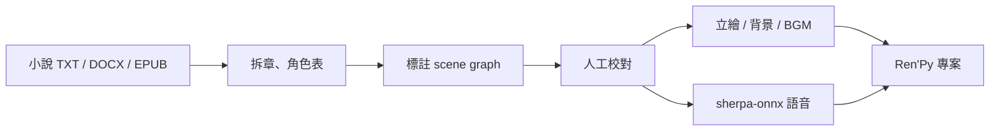

# text_2_visual_novel

**把一本小說，變成一個可以玩的視覺小說遊戲。**

你給它小說文字，它幫你把每一段拆成旁白、台詞、說話者與表情，讓你在瀏覽器裡逐句校對，
再產出立繪、背景、音樂，最後輸出一份可以直接開來玩的 Ren'Py 專案。

這是一套「人在迴路」的工具：AI 做粗活，你只做判斷。標註完一定要校對，程式不會替你決定
誰在說話——它只會把沒把握的地方標出來。

> **這個分支（`migrate/fekit`）是前端大改版。** 功能與網址不變，底下的外殼、路由、任務面板、
> 對話框換成了自製的 fekit 套件。改版原因、做了什麼、驗收狀況見
> [這次大改版：前端移植到 fekit](#這次大改版前端移植到-fekit)。


*《示範》第 1 章：立繪、背景、對話框與語音都是這套管線產出的實驗成果。*

---



## 先玩看看

[下載 Windows 試玩版](https://github.com/yamasoo/text_2_visual_novel/releases/latest)（約 96 MB）

解壓後進入資料夾，執行裡面的 `.exe`。不需要安裝 Ren'Py 或 Python。

這是《示範》的實驗章節，不是完整商業版；Windows 第一次執行可能出現 SmartScreen 警告。

## 它能幫你做什麼

| 階段 | 你做什麼 | 它做什麼 |
|---|---|---|
| **匯入** | 選小說資料夾，或直接丟 TXT／Markdown／DOCX／EPUB | 自動拆章、編段落號 |
| **理解** | 按一個鍵 | 讀出章綱、情節點、角色表（誰是誰、是什麼身分） |
| **標註** | 去泡杯茶 | 把每章變成場景與台詞：分場、旁白、說話者、表情、演出效果 |
| **校對** | 左邊原文、右邊劇本，逐句修 | 標出推斷的說話者（`?`）、漏掉的敘述、不逐字的改寫 |
| **美術** | 在「素材」頁挑風格、按生成 | 用 ComfyUI 出生立繪與背景，自動去背、對齊、命名 |
| **聲音** | 選氣氛、按生成 | 產生 BGM 與環境音；可選 **sherpa-onnx 固定聲線**逐句配音（CPU、不需 ComfyUI），輸出 OGG 與 `VoiceMap.json` |
| **輸出** | 填一次 Ren'Py SDK 路徑 | 產生可執行的 Ren'Py 專案，並檢查缺素材、字型缺字 |
| **驗收** | 按「開始驗收」 | 打包成 QA 包，用截圖驗證畫面與流程 |

## 你會得到什麼

- **可以玩的遊戲** — Ren'Py 專案，開起來就能跑，也能打包成 Windows 執行檔
- **校對過的劇本** — `works/<書>/scenes/chNNN.json`（機器可讀，之後要改編或重出都靠它）
- **給人看的校對表** — `scenes/chNNN_review.md`，可以直接拿給別人審
- **素材庫** — 立繪、背景、BGM、音效，統一命名與清單管理
- **可重複的流程** — 同一本書改幾句、重跑一章，不用從頭來


*同一個 Ren'Py 專案的主選單；背景圖也是管線產出的素材。*

## 需要什麼

**必備**

| 項目 | 說明 |
|---|---|
| Windows 10／11 | 目前只在 Windows 實測過 |
| Python 3.10 以上 | 先確認電腦已安裝；不需要重裝，也不要覆蓋既有 Python |
| 小說文字 | TXT／Markdown／DOCX／EPUB；程式**只讀不寫**，不會動到你的原稿 |
| 一個 LLM | [DeepSeek API 金鑰](https://platform.deepseek.com/)，或本機跑的 llama.cpp |

**選配（沒有也能用，只是少幾步）**

| 項目 | 什麼時候需要 |
|---|---|
| ComfyUI ＋ 顯示卡 | 想自動生立繪／背景、BGM 時 |
| `sherpa-onnx`（`requirements-tts.txt`）＋約 116 MB 中文模型 | 想用 sherpa-onnx 固定聲線配音時（CPU，不需要 ComfyUI） |
| ffmpeg | 想處理音樂音效、或把語音轉 OGG 時 |
| [Ren'Py SDK 8.x](https://www.renpy.org/latest.html) | 想輸出成遊戲時 |

**資源量級**：一本 20 萬字的小說，作品資料夾大約 1–3 GB（多數是圖片）。
顯示卡用於出圖，沒有也可以先做劇本、之後再補圖。

### 先檢查環境（已安裝可跳過）

先開 PowerShell 確認版本；**不要為了這個專案重裝 Python**，以免影響其他環境：

```powershell
python --version
git --version
ffmpeg -version
```

如果缺少：

- Python 3.10+：<https://www.python.org/downloads/windows/>（安裝時勾「Add Python to PATH」；已有 Python 就跳過）
- Git：<https://git-scm.com/download/win>
- ffmpeg：<https://ffmpeg.org/download.html>
- Ren'Py SDK 8.x：<https://www.renpy.org/latest.html>

`start_studio.bat` 只會在專案內建立 `venv\`，不會把套件裝進你的全域 Python。

**語音模型不在 GitHub**，第一次使用請跑：

```powershell
.\venv\Scripts\python.exe -m pip install -r requirements-tts.txt
.\venv\Scripts\python.exe tools\sherpa_get_model.py vits-zh-hf-fanchen-C
```

完整步驟見 [36_語音快速開始.md](docs/36_語音快速開始.md)。

## 怎麼開始

```powershell
git clone https://github.com/yamasoo/text_2_visual_novel.git
cd text_2_visual_novel
.\start_studio.bat
```

第一次執行會自動建虛擬環境、裝好套件、產生 `config.yaml`，然後打開
<http://127.0.0.1:7866/>。

打開後到 **設定** 頁，用「作品存放位置」和「書庫位置」的 **瀏覽…** 直接選資料夾即可，
**不需要手動編輯 `config.yaml`**。

只有在設定頁無法開啟時，才需要手動檢查 `config.yaml` 的 `book_library.path`。

接著在網頁上：

1. **書架** → 匯入一本書
2. 勾章節 → **抽取章綱與角色**
3. 勾章節 → **AI 標註**（背景執行，可以看進度和花費）
4. **章節** → 打開校對，把 `?` 和紅色提示修掉
5. 想先看看 → **建立可玩原型**（HTML，不用 Ren'Py）
6. 想配音 → 先照 [語音快速開始](docs/36_語音快速開始.md) 下載 sherpa 模型 → **語音**頁填聲線 → 生成 → 重新匯出
7. 要正式版 → 設定 Ren'Py 路徑 → **匯出**

## 費用大概多少

成本幾乎都在 LLM 的 token。以 DeepSeek 的便宜模型計算，一章通常是幾萬 token，
全書數十萬 token，換算下來是「一杯飲料到一頓飯」的量級；如果重試很多次會再往上。
用本機 llama.cpp 則完全免費，代價是慢、而且需要夠大的顯示記憶體。

金鑰只存在 Windows 憑證管理員（keyring），從網頁「設定」頁填入，**不會寫進檔案、不會上傳**。

## 常見問題

**Q：一定要有 API 金鑰嗎？**
不一定。可以先用本機模型（llama.cpp）跑小章節試水溫；也可以只匯入、只校對，不呼叫模型。

**Q：它會改我的原稿嗎？**
不會。小說資料夾是唯讀的，所有產出都寫在 `works/`。

**Q：標註完可以直接用嗎？**
強烈建議校對。AI 很會抓場景與對白，但「這句話是誰說的」常常需要人判斷，所以介面會把
沒把握的行標成 `?`。

**Q：可以只做劇本、不做美術嗎？**
可以。輸出時缺的素材會用佔位圖補上，先能玩，之後再補。

## 這次大改版：前端移植到 fekit

### 為什麼要換

舊前端的骨架是自己刻的，很多基礎設施每頁各寫一次：

- `ui/shell.js` 自己做三欄外殼（拖曳調寬、收合、記寬度）與右側 AI 面板，面板每 5 秒輪詢
  `/api/jobs/active`。
- `ui/app.js` 自己做路由、`$`、`h()`、`api()`、`toast()`、`modal()`、`dirty`，以及書架／章節／
  校對編輯器。
- 每一頁各自處理「載入中／錯誤／輪詢」，沒有共用的 toast 佇列、路由競態保護、檔案選擇器、
  任務面板；同樣的邏輯要重複寫好幾次。
- 後端也自己刻任務：`Job`／`Jobs`／`StreamBuffer`（串流上限 40 萬字）與 `/api/jobs/*`，
  是另一套獨立的任務狀態機。

### 換成什麼

同 repo 內的 `vendor/fekit/`（版本 `0.0.1`）：免建置的純 `.js`／`.css`，只掛 `window.FE`。

| 部分 | 內容 |
|---|---|
| `fe/core.js` | `h()`、`api()`、`upload`、`toast`、`modal`、`confirm`、`store`、`dirty`、路由（`FE.PAGES`／`FE.start`） |
| `fe/shell.js` | 三欄外殼、麵包屑、窄螢幕抽屜、寬度記憶 |
| `fe/jobs.js` | 任務面板（執行中／停止中／已停止／完成／失敗）、SSE 與輪詢、`seq` 續傳、重新整理接回 |
| `fe/filepicker.js` | 檔案／資料夾選擇器（磁碟機、上一層、可直接輸入完整路徑） |
| `py/fekit/` | `install()`、`JobRunner`、權杖與 Host／Origin 守衛、`/api/fs/list` |

### 做了哪些事

| 階段 | 內容 |
|---|---|
| **後端** | 任務端點改成專案自己的 `/api/fe-jobs/*`；新增 `t2vn/jobs_bridge.py`，把原本 `Job` 的語意（章節狀態、停止、紀錄）鏡射到 fekit 的 `JobRunner`；紀錄改由 `fe.patch(0)` 組出；接上 fekit 的權杖／Host／Origin 守衛與 `/api/fs/list` |
| **外殼與路由** | `ui/index.html` 搬到 `templates/index.html`（由後端送出，權杖寫進 `<meta>`）；新增 `ui/shared.js`（共用常數、`browse()`、`chipClass()`／`tabClass()`）；`ui/shell.js` 改成 fekit shell 的薄殼；舊的 `hashchange` 與自寫 `route()` 全部移除 |
| **逐頁** | 12 頁全部改成 fekit 路由（書架／匯入、章節、角色表、校對編輯器、總覽、設定集、任務紀錄、設定、素材、角色外型卡、音樂、語音、輸出） |
| **收尾** | 刪掉過渡層 `ui/compat.js`、三個舊任務端點、`t2vn/streambuf.py` 與它的測試、舊 `Job` 類別；檔案瀏覽改用 fekit 的檔案選擇器；刪掉 CSS 過渡 class（`.chip.ok`、`.tab.on`…） |
| **驗收** | 依 `docs/qa/驗收清單.md` 逐項實測：外殼（拖曳、鍵盤、寬度記憶、窄螢幕抽屜、主區自捲）、路由競態、任務四態、409、重新整理接回、後端重啟、安全（權杖／Host／Origin／404）、深色、逐頁 |

改完之後：`ui/*.js` 3,787 → 3,728 行（新增 91 行的 `shared.js`，`shell.js` 213 → 113 行）、
`ui/style.css` 183 → 118 行、`t2vn/server.py` 1,100 → 900 行。行數不是重點，重點是外殼、路由、
任務面板、對話框、檔案選擇器都變成可重用的套件，之後其他工具也能直接接。

### 對使用者的影響

- **網址完全沒變**：`#/book/<id>/ch/3`、`#/settings` 這些書籤照用。
- **任務面板更一致**：四態（執行中／停止中／已停止／完成／失敗）、連線中斷會顯示「連線中斷，重試中」、
  重新整理會接回同一個任務、後端重啟會明說「找不到這個任務」而不是一直轉圈。
- **對話框換成站內元件**：原本瀏覽器原生的 `confirm()`／`prompt()` 改成站內對話框，不會再跳系統視窗。
- **任務紀錄相容**：新紀錄的項目是 `{key, state, label}`，**舊紀錄照樣讀得到**（讀取端會轉接，資料不用遷移）。
- **主題**：顏色改吃 fekit 的 tokens（跟隨系統深淺色，或 `data-theme="dark"` 強制），`ui/style.css` 只留刻意的專案覆寫。
- **資料不用動**：`works/` 底下的小說、標註、素材、語音都原封不動。

### 驗收狀況

- `pytest -q`：**927 passed / 13 failed**，13 項是移植前就存在的（annotate 5、chunked 7、export_renpy 1），
  與基線逐項相同 → **沒有新增紅燈**。
- `tools/lint_rules.py` 0 違規；`node --check` 全過；`sync_kit --check` 無漂移（`vendor/fekit/` 與本體同步）。
- 逐頁與全域驗收清單實測結果：**有條件通過**（不通過 0 項）。

### 回退

這個分支就是「新前端」；要回舊版直接切回 `main`。`vendor/fekit/` 是複製進來的副本，
之後升級用 fekit 本體的同步工具（`sync_kit.py --check` 可以看有沒有漂移），不要手改裡面的檔案。

## 這個 repo 裡沒有什麼

為了尊重原稿與授權，以下**不會**出現在 repo 裡（`.gitignore` 已排除）：

- `works/` — 小說原文、標註結果、圖片、遊戲建置產物
- `config.yaml` — 你自己的本機路徑設定
- `vendor/fonts/`、`vendor/wildcards/` — 第三方素材，需要時自行下載
- `models/` — sherpa-onnx 與 ComfyUI 的模型權重，檔案太大，請照文件下載

## 想更深入了解

| 文件 | 內容 |
|---|---|
| [docs/05_資料格式規格.md](docs/05_資料格式規格.md) | 資料夾權限、命名規則、輸入輸出格式 |
| [docs/20_標註規則.md](docs/20_標註規則.md) | 旁白／台詞怎麼拆、說話者怎麼判斷 |
| [docs/30_RenPy匯出規格.md](docs/30_RenPy匯出規格.md) | Ren'Py 專案結構與命名 |
| [docs/31_美術管線規格.md](docs/31_美術管線規格.md) | 立繪、背景與出圖流程 |
| [docs/32_外型卡規格.md](docs/32_外型卡規格.md) | 角色外型與 wildcard 卡池 |
| [docs/34_sherpa模型清單.md](docs/34_sherpa模型清單.md) | sherpa-onnx 中文／粵語模型與下載 |
| [docs/36_語音快速開始.md](docs/36_語音快速開始.md) | 從安裝、下載模型到生成語音的完整指令 |

想跑測試或參與開發：`pip install -r requirements-dev.txt` 後執行 `pytest`。

## 授權

本專案為 MIT，見 [LICENSE](LICENSE)。
`vendor/` 下的程式與素材各自依原授權（`vendor/novel_studio/LICENSE`、`vendor/ruxi/LICENSE`、
`library/sfx/kenney_interface/LICENSE.txt`）。
